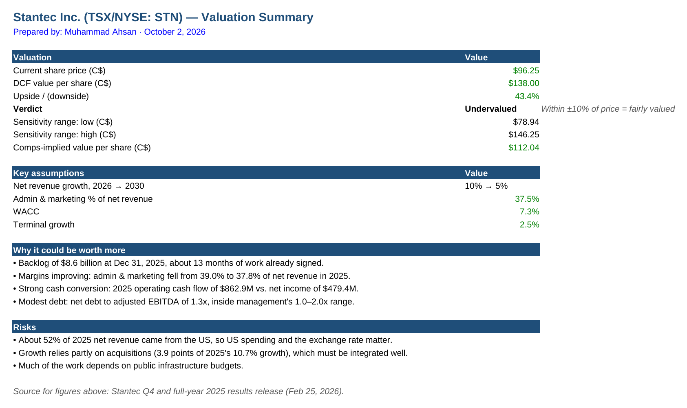
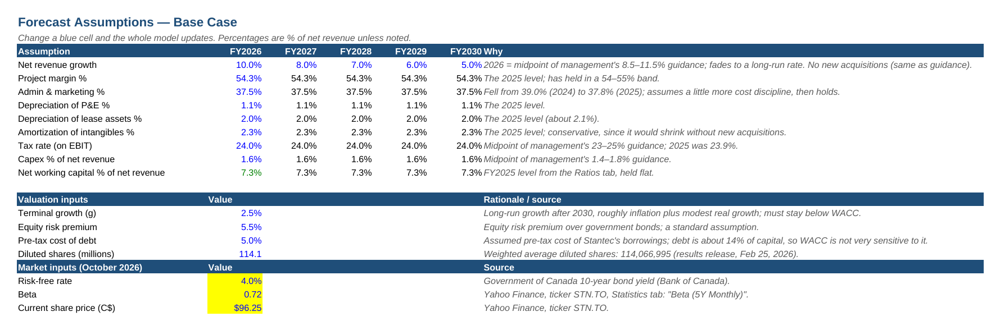
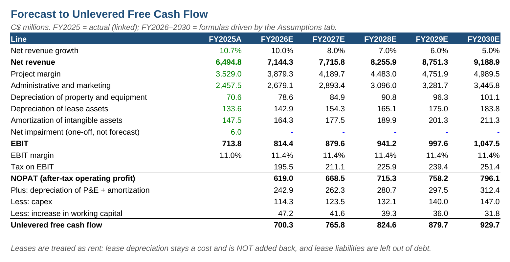
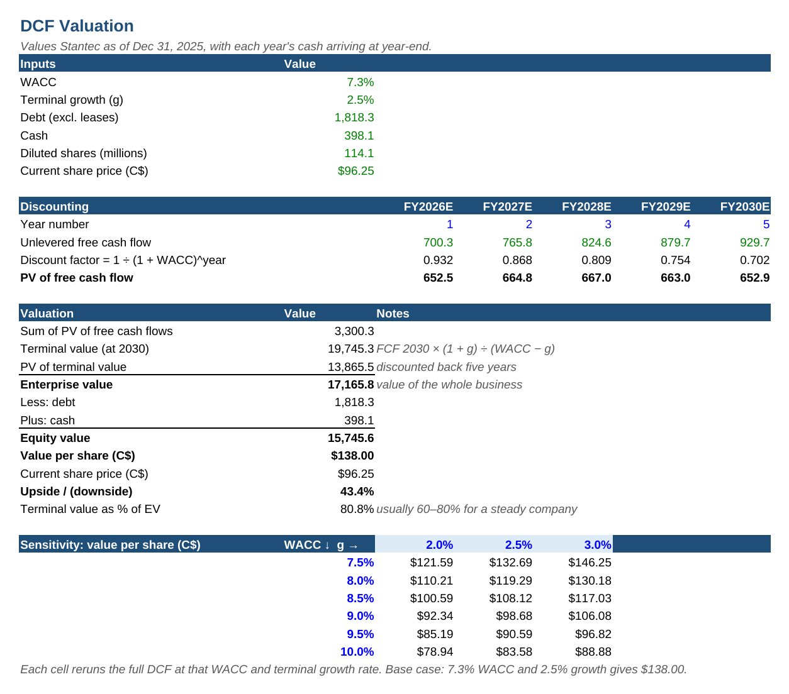

# Stantec (TSX/NYSE: STN) Forecast & DCF Valuation — Excel

**A five-year forecast and discounted cash flow valuation of Stantec Inc., built in Excel from the company's FY2025 results and annual reports and cross-checked against peer EV/EBITDA multiples.**

**Author:** Muhammad Ahsan · [LinkedIn](https://www.linkedin.com/in/ahsan1143) · Level I Candidate in the CFA Program
**Tools:** Excel (three-statement historicals, driver-based forecast, WACC, DCF, sensitivity table, trading comps)

| | Value per share (C$) |
|---|---|
| **DCF (base case)** | **\$138.00** |
| Peer EV/EBITDA comps | \$112.04 |
| Sensitivity range (WACC 7.5–10%, growth 2–3%) | \$78.94 – \$146.25 |
| Share price, October 2026 | \$96.25 |

---

## Findings
- **Both methods point above the share price.** The base-case DCF gives \$138.00 per share (+43% vs. \$96.25) and the peer median EV/EBITDA multiple of 13.8x gives \$112.04. Stantec trades at 11.6x EBITDA, a 16% discount to the peer median (WSP, AECOM, Tetra Tech, Jacobs).
- **The result leans on the terminal value.** Terminal value is 81% of enterprise value, so the long-run assumptions matter most: at a 9–10% WACC the value falls to \$79–\$106, around today's price.
- **What supports the upside:** an \$8.6B backlog (about 13 months of work), admin and marketing costs down from 39.0% to 37.8% of net revenue in 2025, operating cash flow of \$863M against \$479M of net income, and net debt to adjusted EBITDA of 1.3x.
- **Risks:** about 52% of net revenue comes from the US (spending and the exchange rate), 3.9 points of 2025's 10.7% growth came from acquisitions, and much of the work depends on public infrastructure budgets.

## Model structure
| Tab | What it does |
|---|---|
| **Historicals** | FY2023–2025 income statement, balance sheet and cash flow from the results release and annual reports; a check row ties calculated net income to the reported figure. |
| **Ratios** | Growth, margins, cash conversion, leverage, DSO, working capital and return on equity. |
| **Assumptions** | Base-case drivers, each with its rationale, plus valuation and market inputs. Change a blue cell and the whole model updates. |
| **Forecast** | FY2026–2030 from net revenue down to unlevered free cash flow. |
| **WACC** | CAPM cost of equity, after-tax cost of debt and market-value weights. |
| **DCF** | Discounts free cash flow and a Gordon-growth terminal value to Dec 31, 2025; bridges enterprise value to value per share; WACC × terminal growth sensitivity table. |
| **Comps** | EV/EBITDA for four engineering and design peers from one data source; the peer median applied to Stantec's EBITDA. |
| **Summary** | One-page valuation summary ([PDF](reports/Stantec_Valuation_Summary.pdf)). |

Colour convention: blue = hard-coded input, black = formula, green = link from another tab.

## Key assumptions (base case)
| Driver | Assumption | Basis |
|---|---|---|
| Net revenue growth | 10% (2026) fading to 5% (2030) | 2026 = midpoint of management's 8.5–11.5% guidance; no new acquisitions |
| Project margin | 54.3% of net revenue | 2025 level; has held in a 54–55% band |
| Admin & marketing | 37.5% of net revenue | Fell from 39.0% to 37.8% in 2025; a little more cost discipline, then flat |
| Tax rate on EBIT | 24% | Midpoint of management's 23–25% guidance |
| Capex | 1.6% of net revenue | Midpoint of management's 1.4–1.8% guidance |
| Net working capital | 7.3% of net revenue | FY2025 level, held flat |
| Terminal growth | 2.5% | Roughly inflation plus modest real growth |
| WACC | 7.3% | Risk-free 3.95% (GoC 10-year), beta 0.72, ERP 5.5% → cost of equity 7.9%; after-tax cost of debt 3.8%; 86% equity / 14% debt |

## Method notes
- **Valuation date** Dec 31, 2025, with each year's cash flow at year-end.
- **Leases are treated as rent:** lease depreciation stays in operating costs and is not added back, and lease liabilities are left out of debt, so EBITDA, free cash flow and net debt use one consistent definition.
- **Impairment** (one-off) is not forecast. Amortization of intangibles is held at the 2025 rate, which is conservative without new acquisitions.

## Files
| File | Contents |
|---|---|
| `Stantec_DCF_Model.xlsx` | The model (nine tabs, live formulas). |
| `reports/Stantec_Valuation_Summary.pdf` | One-page summary. |
| `reports/figures/` | Screenshots of the summary, assumptions, forecast and DCF tabs. |

**Related:** the model feeds my [Stantec Financial Performance Dashboard](https://github.com/Ahsan1143/stantec-financial-dashboard) in Power BI.

## Sources
- Stantec Q4 and full-year 2025 results release (Feb 25, 2026), investors.stantec.com.
- Stantec 2025 and 2024 Annual Reports (stantec.com, SEDAR+ or SEC EDGAR).
- Market inputs (October 2026): Government of Canada 10-year yield (Bank of Canada); beta and share price (Yahoo Finance, STN.TO); peer EV/EBITDA multiples from a single data source.

*The forecast and valuation are my own estimates from public information and are not investment advice.*
